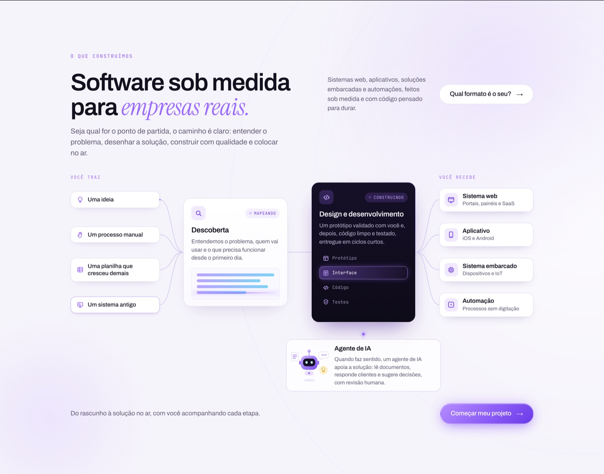
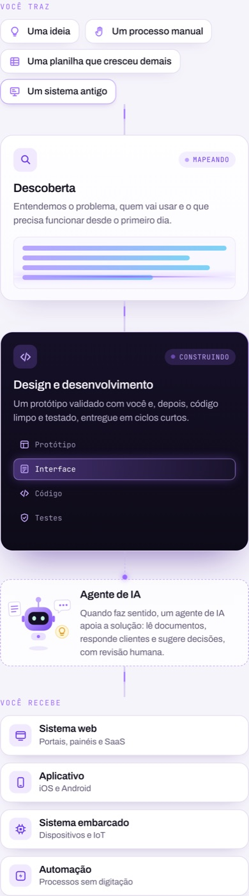

# Alfa Dev · referência de design

Este documento registra as decisões aprovadas do site. A seção **"O que construímos" (Serviços)** foi aprovada integralmente em 12/10/2026 (textos, posições, animações) e é o **padrão de qualidade** para qualquer seção nova ou refeita.





---

## 1. Seção "O que construímos" (`#servicos`) — referência aprovada

### Textos (PT)
| Elemento | Texto |
|---|---|
| Eyebrow | O QUE CONSTRUÍMOS |
| Título | Software sob medida / para *empresas reais.* (a segunda parte em serifa itálica violeta) |
| Subtítulo | Seja qual for o ponto de partida, o caminho é claro: entender o problema, desenhar a solução, construir com qualidade e colocar no ar. |
| Texto lateral | Sistemas web, aplicativos, soluções embarcadas e automações, feitos sob medida e com código pensado para durar. |
| Botão lateral | Qual formato é o seu? → (leva para `#para-quem`) |
| Coluna 1 · VOCÊ TRAZ | Uma ideia · Um processo manual · Uma planilha que cresceu demais · Um sistema antigo |
| Nó 1 · Descoberta (status MAPEANDO) | Entendemos o problema, quem vai usar e o que precisa funcionar desde o primeiro dia. |
| Nó 2 · Design e desenvolvimento (status CONSTRUINDO) | Um protótipo validado com você e, depois, código limpo e testado, entregue em ciclos curtos. Etapas: Protótipo → Interface → Código → Testes |
| Agente de IA (apoio, fora do fluxo principal) | Quando faz sentido, um agente de IA apoia a solução: lê documentos, responde clientes e sugere decisões, com revisão humana. |
| Coluna 4 · VOCÊ RECEBE | Sistema web (Portais, painéis e SaaS) · Aplicativo (iOS e Android) · Sistema embarcado (Dispositivos e IoT) · Automação (Processos sem digitação) |
| Rodapé | Do rascunho à solução no ar, com você acompanhando cada etapa. + botão **Começar meu projeto →** |

Todas as strings têm tradução EN em `window.ALFA_I18N` (chaves `svc.*`).

### Layout
- **Desktop (≥1100px):** grid de 7 colunas `0.9fr | 56px | 1.05fr | 56px | 1.05fr | 56px | 0.95fr` (entradas, conector, Descoberta, conector, Design e desenvolvimento, conector, entregas).
- **Alinhamento das conexões:** as colunas de entradas e entregas têm 4 linhas de altura igual, então os centros caem em 12,5 / 37,5 / 62,5 / 87,5%. Os conectores são SVG `viewBox 0 0 100 100` com `preserveAspectRatio="none"` e `vector-effect: non-scaling-stroke`, convergindo/divergindo para 50%.
- Rótulos "VOCÊ TRAZ" / "VOCÊ RECEBE" ficam acima das colunas (posição absoluta, mono, violeta, espaçado).
- **Agente de IA:** pendurado abaixo do nó escuro, ligado por linha tracejada vertical; largura maior que o nó (`left/right: -24%`). O `.flow` reserva `padding-bottom: 150px` para ele.
- **Mobile/tablet (<1100px):** pipeline vertical. Entradas viram chips em linha, conectores viram linha vertical com gota animada, entregas em grade 2×2 (1 coluna abaixo de 480px), agente logo abaixo do nó escuro.

### Animações (ciclo de 4s, `--cycle`)
| Elemento | Efeito |
|---|---|
| Conectores | Pulso de luz violeta percorre cada fio (`stroke-dasharray` + `pathLength=100`), com atrasos escalonados: entradas 0–1,05s → meio 1,6s → saídas 2,5–2,8s |
| Chips de entrada | Borda acende quando o pulso sai (`flow-ping`) |
| Descoberta | Linha de leitura desce e as barras se preenchem em sequência |
| Design e desenvolvimento | Borda com luz girando (`@property --flow-ang` + conic-gradient) e destaque que percorre Protótipo → Interface → Código → Testes |
| Entregas | Cartão pisca e desliza 3px quando o pulso chega (`flow-land`) |
| Status | Ponto piscando em cada pill (MAPEANDO, CONSTRUINDO) |
| Agente de IA | Robô SVG que flutua, pisca os olhos, antena alterna violeta/verde; ícones de documento, balão e lâmpada balançam em volta; ponto vai e volta na linha tracejada |

### Regras de performance aplicadas
- Animações pausam fora da tela: qualquer elemento com `data-live` recebe `.is-live` via IntersectionObserver; `[data-live]:not(.is-live) * { animation-play-state: paused }`.
- `prefers-reduced-motion`: tudo estático, sem pulsos.
- Nada de `backdrop-filter` em elemento animado; nada de efeito 3D de mouse (removido a pedido).

---

## 2. Princípios gerais do site (aprovados)
- **Paleta:** fundo `--ink #0A0812`, seções claras `--paper #F6F4FB`, acento `--violet #9B6BFF` e gradiente `--grad`. Verde (`#2BB673`/`#7BE0B0`) só para estados "ok/ao vivo".
- **Tipografia:** Archivo (texto e títulos), Instrument Serif itálico só no trecho de destaque do título, JetBrains Mono para eyebrows, status e rótulos.
- **Logo:** "α" desenhado em SVG (traço único com gradiente `#brand-grad`) + "Alfa" 600 + "Dev" 400 em cinza-lavanda; sem caixa, sem brilho.
- **Movimento:** ilustrações vivas que contam o que o serviço faz (pulsos, etapas acendendo), nunca efeito decorativo de scroll-reveal nem tilt 3D.
- **Colunas fixas (sticky):** título à esquerda fixo enquanto o conteúdo rola (Para quem, Dúvidas, card de próximos passos no Contato).
- **IA:** aparece como apoio, não como protagonista.
- **Honestidade:** sem números ou cases inventados; exemplos são rotulados como exemplos.

---

## 3. Idiomas (PT e EN em páginas separadas)
- **PT** em `/` (`index.html`) é a **fonte única**. **EN** em `/en/` (`en/index.html`) é **gerado**; não edite à mão.
- Textos em inglês ficam em `i18n/en.json`. Todo elemento traduzível no `index.html` tem `data-i18n` (texto), `data-i18n-html` (HTML interno), `data-i18n-aria` (aria-label) ou `data-i18n-ph` (placeholder).
- Depois de qualquer mudança no `index.html` ou no `en.json`, rode:

  ```sh
  python3 tools/build_en.py
  ```

  O script falha se faltar alguma chave em inglês. Ele também traduz o `<head>` (title, description, Open Graph), os dados estruturados (organização e FAQ) e ajusta caminhos relativos (`../assets/`, `../demos/`).
- As duas páginas se referenciam com `hreflang` (pt-BR, en, x-default = PT) e o `sitemap.xml` lista as duas.
- O seletor PT/EN do header é um link entre as páginas; links antigos com `#en` redirecionam para `/en/`.
- As demos em `demos/` existem só em PT.

## 4. Demos de soluções (`demos/`)
Seis páginas independentes, uma por card da seção "Exemplos de soluções": `portal`, `app-campo`, `iot`, `automacao`, `documentos`, `assistente`. Todas usam `demos/demo.css` (tokens e header compartilhados) e partem de `demos/_template.html`. Dados fictícios, sem rede, estado em `localStorage` com botão "Restaurar demonstração".

## 5. Publicação
O GitHub Pages publica a branch `gh-pages` em `alfadev.com.br` (arquivo `CNAME`). A `master` guarda o código-fonte; `docs/`, `tools/`, `i18n/` e `demos/_template.html` não vão para a `gh-pages`.
